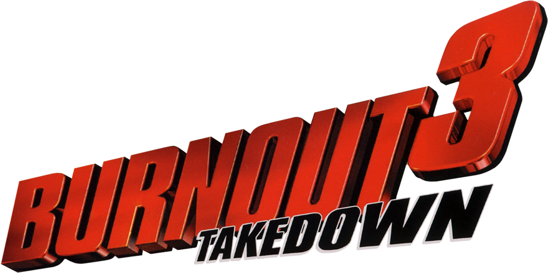
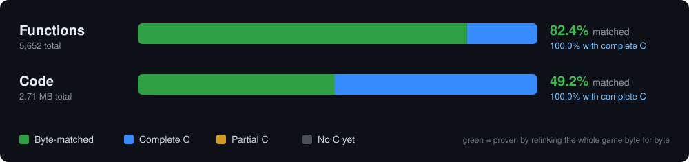
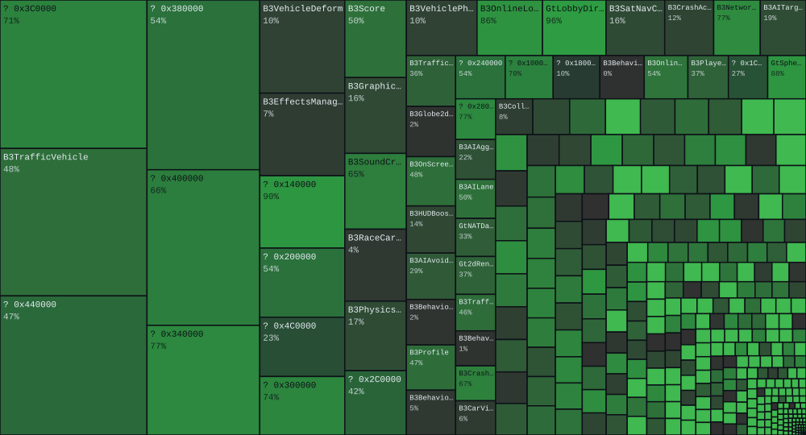
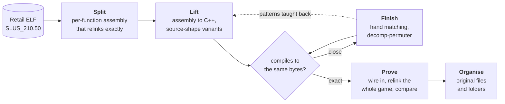

  

<h3 align="center">A matching decompilation of Burnout 3: Takedown for PlayStation 2</h3>

C/C++ source that rebuilds the retail executable <b>byte for byte</b>, 
filed in Criterion's own folder structure.

<!-- badges:start -->

  
  
  
  
  

<!-- badges:end -->

  
  
  

  <a href="docs/known.md"><b>Ledger</b></a> &nbsp;·&nbsp;
  <a href="docs/layout.md"><b>Source layout</b></a> &nbsp;·&nbsp;
  <a href="docs/conventions.md"><b>Conventions</b></a> &nbsp;·&nbsp;
  <a href="docs/matching-patterns.md"><b>Matching patterns</b></a>

 

<!-- progress:start -->
## Progress

| State | Functions | | Code | |
|:---|---:|---:|---:|---:|
| 🟩 &nbsp;**Byte-matched** | 4,655 | 82.4% | 1.33 MB | 49.2% |
| 🟦 &nbsp;**Complete C** | 997 | 17.6% | 1.38 MB | 50.8% |
| 🟧 &nbsp;**Partial C** | 0 | 0.0% | 0 KB | 0.0% |
| ⬛ &nbsp;**No C yet** | 0 | 0.0% | 0 KB | 0.0% |
| **Total game code** | **5,652** | | **2.71 MB** | |

- **Byte-matched:** rebuilt byte for byte, proven by relinking the whole game against retail.
- **Complete C:** behaviour-equivalent to retail and audited against it (`tools/behaviour_audit.py`), but compiles to different bytes. Lives in `src/nonmatching/` for the PC port.
- **Partial C:** drafted, with regions still missing.

170 of 355 known source files complete &middot; 173 started &middot; 4,630 units proven &middot; pipeline cycle 823 &middot; updated 2026-11-09 (commit #5522) &middot; game code only; only byte-matched code counts toward the match, and non-matching C is never linked into the matching build

Function names: game code 2,692 of 5,641 named (48%), 2,949 still `func_XXXXXXXX`; libraries 2,565 of 3,454 named (74%), 889 still `func_XXXXXXXX` (glabels in `assembly/asm`)

One tile per original source file, sized by its code and shaded by how much of it is proven. Tiles marked `? 0x...` hold functions whose file is not evidenced yet.
<!-- progress:end -->

## How it works

- **Split.** The retail executable becomes per-function assembly that relinks to the exact retail image. That build is the safety net under everything.
- **Lift.** `tools/tiny_lift.py` turns a function into C++ and searches source-shape variants: bool and early returns, switch layout, call signatures read from the callee, and VU0 vector inlines from `include/b3/GtMathPs2.h`.
- **Finish.** Near-misses go to hand matching (`build/vt/hand/BRIEF.md`) and [decomp-permuter](https://github.com/simonlindholm/decomp-permuter). Whatever they learn is taught back to the lifter.
- **Prove.** `tools/cycle.py` runs batch. Each candidate is compiled, wired in and the whole game relinked against retail, groups of ten at a time (`tools/group_prove.py`). Only then is it committed.
- **Organise.** Functions are regrouped into their original translation units (`tools/tu_merge.py`), with a full rebuild check after every step.

## Target

| Game | Platform | Region | Serial | Executable |
|---|---|---|---|---|
| Burnout 3: Takedown | PlayStation 2 | NTSC-U | SLUS-21050 | `SLUS_210.50` |

| | |
|---|---|
| ELF SHA-1 | `332be40d6081b8b5055a6ea01194ad6ff662a863` |
| Loaded image (`.main`) SHA-1 | `817cfb412af2d81d4b5fda7b57837b4e28442dfc`, which every proof relinks to exactly |
| Compiler | Metrowerks CodeWarrior for PS2 **3.0.1 build 119** (`mwccps2 -O4 -Cpp_exceptions off -inline level=8`); all 22 available builds were swept ([N139](docs/known.md)) |
| Libraries | RenderWare 3.6 and Sony SDK 2.8, linked in retail and outside the game-code count |

<b>Repository layout</b>

 

| Path | What it is |
|---|---|
| `src/b3/` | matched source, in Criterion's folder structure where evidenced; `_unclassified/` until a file's area is known |
| `src/nonmatching/` | close attempts kept for later; not built and not counted |
| `include/b3/` | shared headers (`GtMathPs2.h` is the VU0 vector library; `classes/` holds consolidated class layouts) |
| `assembly/`, `config/` | the split retail executable and its build and link configuration |
| `tools/` | lifter, provers, pipeline, diff, layout and research tools |
| `research/` | symbol and name tables (Burnout 2, Revenge and E-build maps), hardware references, community patch maps |
| `docs/` | status, evidence ledger, layout rationale, conventions |

## Acknowledgements

- [Hidden Palace](https://hiddenpalace.org/) for preserving the Burnout prototype disc images. The prototype builds'
  link maps, debug symbols and assert data are where this project's names come from.
- [The Cutting Room Floor](https://tcrf.net/) for their research into the prototypes and what they contain.
- **Nahelam** for the retail function names: they were checked against the code and the ones that agreed were
  merged into our name tables (`docs/known.md` N90).

## License

MIT for the original work here: see [`LICENSE`](LICENSE) and [`NOTICE.md`](NOTICE.md) (the game itself is not covered).

## Ground rules

> [!NOTE]
> **Names are never invented.** Every class, function and field name comes from an evidenced symbol table. Anything else is a placeholder (`func_XXXXXXXX`, `UnkStruct_XXXX`, `field_XX`, `vfunc_XX`).
>
> **Every conclusion carries its evidence**, tagged `[C]` confirmed, `[L]` likely or `[G]` guess.
>
> **A match counts only when the harness proves it.**

> [!NOTE]
> **No game data in this repository.** You need your own copy of the game and your own compiler to build or verify anything: see [`docs/SETUP.md`](docs/SETUP.md). Proprietary SDKs and licence files are never part of the project; they are referenced by name only.
